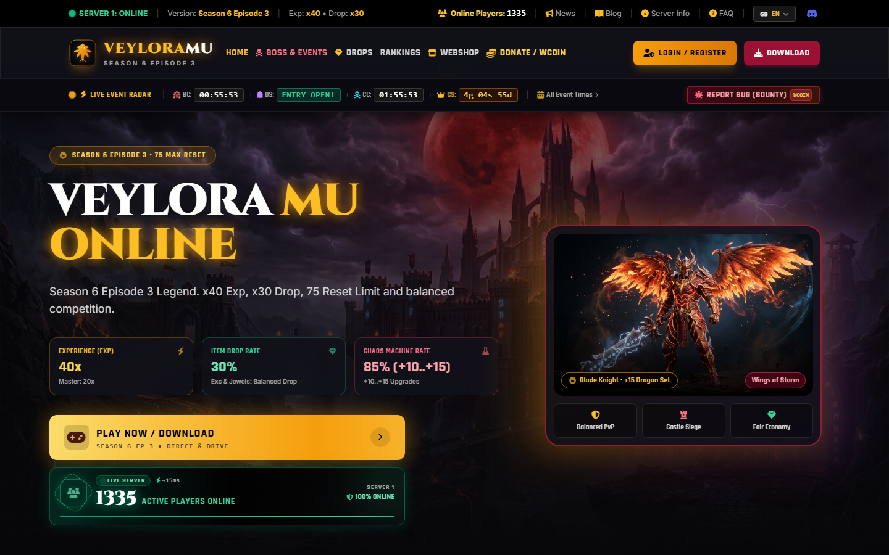

# ⚔️ Next-Gen MU Online Web Panel & CMS (Season 1 to Season 20+)

<div align="center">


<br/>

**A premium, enterprise-grade, mobile-first MU Online Web Panel and Content Management System built for high-traffic servers.**  
*Includes a full turnkey installation, database migration, and emulator integration service for any MU Online server files.*

[🌐 Live Demo (Canlı Demo)](https://veyloramu.com) • [❓ FAQ (Sık Sorulan Sorular)](#-frequently-asked-questions-faq) • [📧 Purchase / Contact (İletişim)](#-commercial-inquiries--contact-ileti%C5%9Fim) • [🇹🇷 Türkçe Açıklama](#-t%C3%BCrk%C3%A7e-tan%C4%B1t%C4%B1m--detaylar)

<br/>

[](https://veyloramu.com)

</div>

---

## 📌 Language Navigation
- [🇬🇧 English Documentation](#-english-overview)
- [🇹🇷 Türkçe Tanıtım & Detaylar](#-t%C3%BCrk%C3%A7e-tan%C4%B1t%C4%B1m--detaylar)

---

## 🇬🇧 English Overview

### 💎 What is this?
This is a **commercial-grade, full-featured MU Online Web Engine & CMS** engineered with modern web standards (PHP 8.2+ PDO, Tailwind CSS, Vanilla JS, and asynchronous REST APIs). It replaces outdated 2000s-era MU panels with an ultra-fast, mobile-first, and SEO-optimized digital portal.

> **Note:** This repository is a product showcase and architectural overview. Full commercial licenses, turnkey deployment, and customization are provided upon purchase.

---

### 🚀 Complete System Features Matrix

| Module | Features & Capabilities |
| :--- | :--- |
| **🎨 Modern UI/UX** | Dark fantasy luxury aesthetic built on **Tailwind CSS 3.4**, micro-interactions, responsive mobile drawer menu, zero heavy external dependencies, sub-500ms load times. |
| **🌐 Dynamic Multi-Lingual SEO** | Full 4-language support (**English, Turkish, Spanish, Portuguese**) with automatic localized URL routing (`/news/slug`, `/blog/slug`), dynamic hreflangs, Google JSON-LD schema, automated sitemap generator, and robots.txt. |
| **🗡️ Real-Time Drops & Spot Engine** | Searchable monster drop directory, exact spot coordinates (X, Y), item category filters, drop probability percentages, and boss spawn schedules (Kundun, Medusa, Selupan, Nightmare, Maya, Balgass, Erohim). |
| **⚖️ Class Balance & PvP Lab** | Dedicated laboratory page for all 7 legendary classes (DK, DW, Elf, MG, DL, Summoner, RF) with real damage formulas, defense calculations, attack speed thresholds, and matchup balance analysis. |
| **📖 In-Game MuHelper & Guides** | Complete player guide covering MuHelper configuration (auto-buffs, skill rotations, item collection filters) and all in-game server commands (`/post`, `/add`, `/reset`, `/masterreset`, `/store`, `/offstore`, `/pack`). |
| **🏆 Competitive Ranking Leagues** | Reset, Master Reset, Level, Guild, and PvP Killer leaderboards with automated weekly reward leagues, reset cap adaptations, and automated prize distribution. |
| **🛍️ Integrated Web Shop & Cash Shop** | Multi-currency (WCoins, CashPoints, Goblin Points, Zen), automated instant in-game delivery without client restart/re-login, stock controls, and VIP tier integrations. |
| **👤 User Account Management** | Fixed full-screen modal authentication, account registration with strength meter, self-service character tools (Unstick character, Clear PK, Reset Stats), and secure password recovery. |
| **🛡️ Enterprise Security** | 100% Prepared PDO statements (SQL Injection immune), strict XSS filtering, rate-limiting (Anti-Brute-Force), CSRF tokens, and configurable password hashing (MD5, SHA256, BCrypt, Argon2/PBKDF2). |

---

### 🕹️ Supported Server Files & Compatibility

Our universal PDO database abstraction layer allows seamless connectivity to any MU Online emulator or database engine:

| Server Emulator | Database | Supported Seasons | Key Integration Features |
| :--- | :--- | :--- | :--- |
| **OpenMU** | PostgreSQL | Season 6 Ep 3, Season 9+ | Direct DB & REST API bridge, instant Cash Shop delivery, live server status |
| **MuEmu / X-Team** | Microsoft SQL Server | Season 4, Season 6, Season 8 | WCoin / Goblin Points sync, VIP system, Master Reset, character armory |
| **Louis Emulator** | Microsoft SQL Server | Season 4, Season 6, Season 8, S12 | Custom drop list integration, off-leveling stats, custom jewel logs |
| **IGCN** | Microsoft SQL Server | Season 9 through Season 20+ | Modern packet & DB structures, Pentagram & Socket visualizer |
| **DarksTeam / Old School** | MSSQL / MySQL | 97d, 99b, Season 1 - Season 3 | Classic reset engines, simple stat recalculations, retro theme compatibility |

---

### 🛠️ Turnkey Setup & Customization Service (*Anahtar Teslim Kurulum*)

When you purchase the panel, **you do not need to deal with complicated installation manuals or SQL queries**. We handle everything for you:

1. **VPS / VDS Deployment:** Full installation on Linux (Ubuntu/Debian/AlmaLinux) or Windows Server (Nginx, Apache, IIS, or Docker).
2. **Database Mapping:** Customized PDO queries mapped precisely to your emulator's database structure and custom item tables.
3. **Custom Branding:** Integration of your server logo, domain, custom color schemes, social media links, and download mirrors.
4. **Automated Cron Jobs:** Setup of automated ranking resets, weekly rewards, database backups, and drop table synchronizations.
5. **Discord Webhook Alerts:** Real-time discord notifications for new registrations, boss kills, and market transactions.
6. **Launch Support:** Direct priority support before and during your server opening day.

---

### 📸 Showcase Gallery

<div align="center">

#### 🗡️ Searchable Monster Drop & Spot Engine
[](https://veyloramu.com/drops.php)

#### 🏆 Player & Guild Ranking Hall of Fame
[](https://veyloramu.com/rankings.php)

#### 📰 Dynamic Multi-Lingual SEO Blog & Announcements
[](https://veyloramu.com/news.php)

#### 📱 Authentic Mobile Responsive Views (Lightshot Captures)
<p align="center">
  
  &nbsp;&nbsp;&nbsp;&nbsp;
  
</p>

</div>

---

### ❓ Frequently Asked Questions (FAQ)

<details>
<summary><b>1. Does this web panel truly work with OpenMU Season 6 Episode 3?</b></summary>
<br/>
<b>Yes, absolutely 100%.</b> The web panel was specifically engineered and thoroughly tested on a live, production OpenMU Season 6 Episode 3 server (<a href="https://veyloramu.com">https://veyloramu.com</a>). It natively connects with OpenMU's ConnectServer, GameServer, ChatServer, and PostgreSQL database with zero compatibility layers.
</details>

<details>
<summary><b>2. Can WebShop items be safely delivered while the character is online?</b></summary>
<br/>
<b>Yes.</b> The WebShop delivery mechanism utilizes atomic, ACID-compliant PDO transactions. Items, currency, or VIP status are injected directly into the player's account vault/inventory safely in real time without requiring the player to log out (re-log) and without any risk of duplication or item loss.
</details>

<details>
<summary><b>3. Are the PostgreSQL queries compliant with OpenMU's active schema?</b></summary>
<br/>
<b>Yes, 1:1 compliant.</b> OpenMU's EF Core PostgreSQL schema (including Account, Character, StatAttribute, ItemStorage, Guild, and binary/JSON configurations) has been analyzed down to the byte. User registration, password hashing (PBKDF2/Argon2/BCrypt), stats allocation, and reset queries align perfectly with OpenMU conventions.
</details>

<details>
<summary><b>4. Is the license per single server and perpetual (lifetime)? Are updates included?</b></summary>
<br/>
<b>Yes.</b> The license is issued for a <b>single server IP address</b> (or bound domain) with <b>perpetual lifetime access</b> (no recurring monthly fees). All bug fixes, security patches, and system optimization updates within the version line are included.
</details>

<details>
<summary><b>5. Is the backend source code delivered, or is it an obfuscated/executable closed binary?</b></summary>
<br/>
<b>The backend PHP source code is delivered to the customer.</b> However, the software includes a lightweight licensing verification module locked to your agreed server IP or domain name. You have complete freedom to host, inspect, and manage the code on your server.
</details>

---

<br/>

## 🇹🇷 Türkçe Tanıtım & Detaylar

### 💎 Bu Proje Nedir?
Bu proje; eski, hantal ve güvenlik açıklarıyla dolu 2000'li yıllardan kalma klasik MU web panellerini tarihe gömen; **PHP 8.2+ PDO, Tailwind CSS, 4 dilli dinamik SEO altyapısı ve modern asenkron API mimarisiyle** sıfırdan geliştirilmiş **kurumsal MU Online Web Paneli & CMS sistemidir.**

> **Önemli Not:** Bu repository tanıtım ve vitrin amaçlıdır. Satın alım durumunda tüm files kurulumu, veritabanı eşleştirmesi ve entegrasyonu tarafımızca anahtar teslim sağlanmaktadır.

---

### 🚀 Sistem Özelliklerinin Tam Listesi (Teyit Edilmiş Özellikler)

1. **Mobil Uyumlu & Ultra Hızlı Arayüz (TailwindCSS 3.4):**
   - Karanlık RPG konseptli modern arayüz (`#0b0b12` lüks arka plan, altın/kehribar vurgular).
   - Akıcı mobil kayar çekmece (drawer) menü; dokunmatik ekranlara tam uyumlu.
   - 500ms altında açılış hızı; gereksiz ağır kütüphanelerden arındırılmış saf performans.

2. **4 Dilli Dinamik SEO & Blog Sistemi (TR, EN, ES, PT):**
   - URL içinde otomatik yerelleştirilmiş slug yapısı (`/news/seo-slug` ve `/blog/seo-slug`).
   - Eski UUID/ID linklerinden yeni SEO linklerine otomatik 301 yönlendirmesi.
   - Dinamik hreflang etiketleri, Google Schema (JSON-LD) ve otomatik `sitemap.xml` üreticisi.
   - Blog, Etkinlik, Duyuru ve Güncelleme kategorilendirmesi.

3. **Canlı Monster Drop & Spot Kılavuzu (`drops.php`):**
   - Canavar adı, düşen eşya, harita veya boss adına göre anlık filtreleme/arama motoru.
   - Eşya düşme olasılığı yüzdeleri, tam spot koordinatları (X, Y) ve harita seviye gereksinimleri.
   - Boss saatleri ve etkinlik drop tabloları (Kundun, Medusa, Selupan, Nightmare, Maya, Balgass, Erohim).

4. **Sınıf Dengeleme & PvP Laboratuvarı (`balance.php`):**
   - 7 Efsanevi Karakter (DK, DW, Elf, MG, DL, Summoner, RF) için özel yüksek çözünürlüklü grafikler.
   - Gerçek hasar, savunma ve saldırı hızı (attack speed) formülleri ve sınıf eşleşme analizleri.

5. **Oyun İçi MuHelper & Komutlar Rehberi (`commands.php`):**
   - MuHelper oto-av ayarları (skill zamanlaması, oto-buff, eşya toplama listesi).
   - Sunucu komutları rehberi (`/post`, `/add`, `/reset`, `/masterreset`, `/store`, `/offstore`, `/pack` vb.).

6. **Haftalık Sıralama Ligi & Şöhretler Salonu (`rankings.php`):**
   - Seviye, Reset, Grand Reset, Lonca (Guild) ve PvP Katil (PK) sıralamaları.
   - Geri sayımlı haftalık yarış ligi ve otomatik ödül havuzu dağıtımı.
   - Maksimum reset sınırına (Cap) ulaşan sunucular için alternatif lig modları (Master EXP, Boss Puanı vb.).

7. **Entegre Web Market / Cash Shop (`market.php` / `shop.php`):**
   - WCoin, CashPoints, Goblin Points ve Zen desteği.
   - Oyundan çıkış yapmayı gerektirmeyen anında çanta/depo eşya teslimatı.
   - VIP üyelik sistemi (Süre takipli Bronz, Gümüş, Altın, Platin paketler).

8. **Kullanıcı Hesabı & Karakter Kurtarma Portalı:**
   - Şık giriş/kayıt modalı ve profil sayfası.
   - Karakter kurtarma (Haritada sıkışan karakteri şehre ışınlama), stat sıfırlama, PK temizleme.
   - MD5, SHA256, BCrypt ve PBKDF2/Argon2 şifreleme uyumluluğu.

9. **Üst Düzey Güvenlik Standartları:**
   - %100 Prepared PDO sorguları (SQL Injection tamamen imkansız).
   - XSS sanitizasyonu, CSRF token koruması, Brute-force ve Rate-limiting kalkanı.

---

### ❓ Sıkça Sorulan Sorular (SSS)

<details>
<summary><b>1. OpenMU Season 6 Episode 3 ile gerçekten çalışıyor mu?</b></summary>
<br/>
<b>Evet, %100 yerel ve tam uyumlu olarak çalışıyor.</b> Panelimiz bizzat aktif ve canlı bir OpenMU Season 6 Episode 3 sunucusunda (<a href="https://veyloramu.com">https://veyloramu.com</a>) test edilmiş olup; ConnectServer, GameServer, ChatServer ve PostgreSQL veritabanı ile kusursuz entegrasyona sahiptir.
</details>

<details>
<summary><b>2. WebShop ürün teslimatı, karakter çevrimiçi olsa bile güvenli şekilde yapılabiliyor mu?</b></summary>
<br/>
<b>Evet.</b> WebShop sistemi, karakter oyundayken (çevrimiçi) dahi güvenli ACID işlemlerine uygun PDO transaction yapısı kullanır. Karakterin oyundan çıkış yapmasına (re-log) gerek kalmadan eşyalar/krediler doğrudan kasaya veya envantere anında ve dupe/kayıp riski olmadan güvenle teslim edilir.
</details>

<details>
<summary><b>3. PostgreSQL sorguları ve hesap işlemleri OpenMU'nun mevcut şemasına uygun mu?</b></summary>
<br/>
<b>Evet, birebir uygundur.</b> OpenMU'nun EF Core / PostgreSQL veritabanı şeması (Account, Character, StatAttribute, Guild, ItemStorage ve binary/JSON yapıları) tam olarak analiz edilmiş olup; hesap kaydı, şifreleme algoritmaları (PBKDF2 / Argon2 / BCrypt), karakter statları ve reset tabloları OpenMU standartlarına tam uyumludur.
</details>

<details>
<summary><b>4. Lisans tek sunucu için mi, süresiz mi? Güncellemeler dahil mi?</b></summary>
<br/>
<b>Lisans tek bir sunucu IP adresi (veya bağlı domain) için tanımlanır ve süresizdir (ömür boyu kullanım).</b> Satın alınan sürüm serisi boyunca yayınlanan hata düzeltmeleri ve sistem optimizasyonu güncellemeleri fiyata dahildir.
</details>

<details>
<summary><b>5. Backend kaynak kodu teslim ediliyor mu, yoksa yalnızca çalıştırılabilir kapalı sistem mi?</b></summary>
<br/>
<b>Evet, backend PHP kaynak kodları teslim edilmektedir.</b> Ancak sistem, satın alma sırasında anlaşılan sunucu IP adresine veya proje domainine lisanslı (domain/IP korumalı) olarak teslim edilir. Alıcı kendi sunucusunda kodları rahatça barındırabilir ve yönetebilir.
</details>

---

### 🛠️ Anahtar Teslim Kurulum & Entegrasyon Hizmeti

Panelimizi satın aldığınızda teknik detaylarla, SQL tablolarıyla veya sunucu ayarlarıyla **asla uğraşmazsınız**. 

1. **Sunucuya Kurulum:** VDS/VPS sunucunuza (Linux Nginx/Apache, Windows Server veya Docker) kurulumu biz yapıyoruz.
2. **Files Entegrasyonu:** Kullandığınız MU filesına (OpenMU, Louis, MuEmu, IGCN vb.) özel veritabanı eşleştirmelerini ve özel item/drop tablolarını eksiksiz bağlıyoruz.
3. **Özel Tasarım Uyarlaması:** Sunucunuzun logosu, renk tonları, indirme linkleri ve sosyal medya butonları yerleştirilir.
4. **Otomasyon & Cronjob:** Otomatik lig ödülleri, sitemap yenileme ve veritabanı optimize cronjob'ları ayarlanır.
5. **Discord Bildirim Botu:** Kayıtlar, market alışverişleri ve sunucu duyuruları için Discord webhook entegrasyonu sağlanır.
6. **Açılış Desteği:** Sunucunuzun açılış gününde teknik ekibimiz hazır bekler.

---

## 📬 Commercial Inquiries & Contact (İletişim)

Paneli satın almak, demo detaylarını görüşmek veya sunucunuza özel teklif almak için bize e-posta yoluyla ulaşabilirsiniz:

- 📧 **Official Email:** [hellonullen@gmail.com](mailto:hellonullen@gmail.com)
- 🌐 **Live Server Demo:** [https://veyloramu.com](https://veyloramu.com)
- 💬 **Discord / Telegram:** *Yakında eklenecektir (talep üzerine e-posta ile iletilir)*

---

## 📄 License & Intellectual Property

```
Copyright (c) 2026 Veylora / Apex MU Web Solutions. All Rights Reserved.
This project is proprietary commercial software licensed per server IP/domain.
Unauthorized copying, decompilation, distribution, or resale is strictly prohibited.
```
