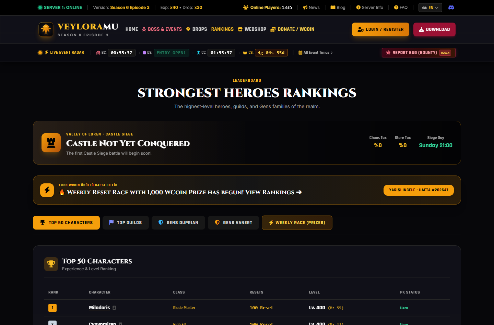
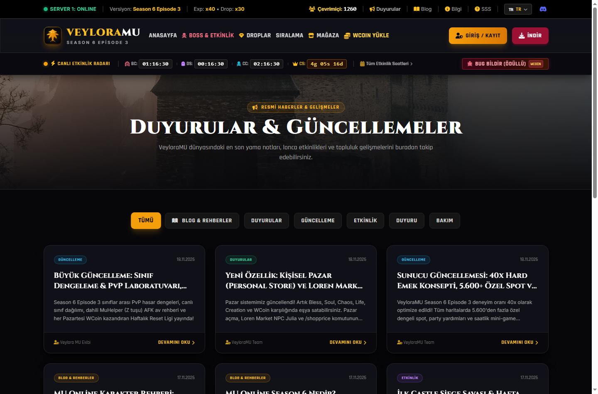
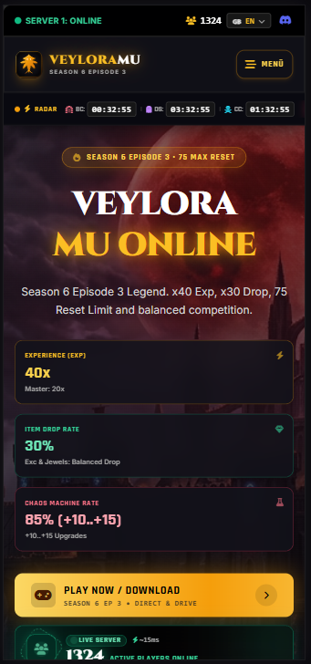
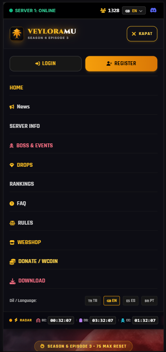

# ⚔️ Next-Gen MU Online Web Panel & CMS (Season 1 to Season 20+)

<div align="center">


<br/>

**A premium, enterprise-grade, mobile-first MU Online Web Panel and Content Management System built for high-traffic servers.**  
*Includes a full turnkey installation, database migration, and emulator integration service for any MU Online server files.*

[🌐 Live Real Server Demo (Canlı Gerçek Demo)](https://veyloramu.com) • [💳 Pricing & Licensing (Fiyatlandırma)](#-pricing--licensing-plans-fiyatland%C4%B1rma) • [❓ FAQ (Soru - Cevap)](#-frequently-asked-questions-faq) • [📧 Purchase / Contact (İletişim)](#-commercial-inquiries--contact-ileti%C5%9Fim)

<br/>

[](https://veyloramu.com)

</div>

---

## 📌 Language Navigation
- [🇬🇧 English Documentation](#-english-overview)
- [🇹🇷 Türkçe Tanıtım & Detaylar](#-t%C3%BCrk%C3%A7e-tan%C4%B1t%C4%B1m--detaylar)

---

## 🇬🇧 English Overview

### 💎 What is this?
This is a **commercial-grade, full-featured MU Online Web Engine & CMS** engineered with modern web standards (PHP 8.2+ PDO, Tailwind CSS, Vanilla JS, and asynchronous REST APIs). It replaces outdated 2000s-era MU panels with an ultra-fast, mobile-first, and SEO-optimized digital portal.

> **Important Note:** The live demo at [https://veyloramu.com](https://veyloramu.com) is **NOT a mock or static template**—it is a **100% REAL, actively running MU Online Season 6 server** connected to live databases and game services.

---

### 💳 Pricing & Licensing Plans

We offer two transparent commercial licensing models tailored to your project:

| Plan | Price | License Scope | Features & Support |
| :--- | :--- | :--- | :--- |
| **Monthly Subscription** | **€19 / month** | 1 Domain + 1 Server IP | Full PHP backend source code, active security patches & system updates, standard tech support. |
| **Lifetime License** *(Recommended)* | **€199** *(One-Time)* | 1 Domain + 1 Server IP | Full PHP backend source code, **Full Turnkey Installation & Setup Service included**, lifetime usage, all version updates & priority launch support. |

> ⚠️ **Licensing Policy:** Each license is cryptographically bound to your designated **Domain Name and Server IP Address**. If the domain or server IP is changed without an authorized migration request, the license becomes invalid. Outside of unauthorized IP/domain changes, lifetime licenses remain valid indefinitely.

---

### 🚀 Complete System Features Matrix

| Module | Features & Capabilities |
| :--- | :--- |
| **🎨 Modern UI/UX** | Dark fantasy luxury aesthetic built on **Tailwind CSS 3.4**, micro-interactions, responsive mobile drawer menu, zero heavy external dependencies, sub-500ms load times. |
| **🌐 Dynamic Multi-Lingual SEO** | Full 4-language support (**English, Turkish, Spanish, Portuguese**) with automatic localized URL routing (`/news/slug`, `/blog/slug`), dynamic hreflangs, Google JSON-LD schema, automated sitemap generator, and robots.txt. |
| **🗡️ Real-Time Drops & Spot Engine** | Searchable monster drop directory, exact spot coordinates (X, Y), item category filters, drop probability percentages, and boss spawn schedules (Kundun, Medusa, Selupan, Nightmare, Maya, Balgass, Erohim). |
| **⚖️ Class Balance & PvP Lab** | Dedicated laboratory page for all 7 legendary classes (DK, DW, Elf, MG, DL, Summoner, RF) with real damage formulas, defense calculations, attack speed thresholds, and matchup balance analysis. |
| **📖 In-Game MuHelper & Guides** | Complete player guide covering MuHelper configuration (auto-buffs, skill rotations, item collection filters) and all in-game server commands (`/post`, `/add`, `/reset`, `/masterreset`, `/store`, `/offstore`, `/pack`). |
| **🏆 Competitive Ranking Leagues** | Reset, Master Reset, Level, Guild, and PvP Killer leaderboards with automated weekly reward leagues, reset cap adaptations, and automated prize distribution. |
| **🛍️ Integrated Web Shop & Cash Shop** | Multi-currency (WCoins, CashPoints, Goblin Points, Zen), automated instant in-game delivery without client restart/re-login, stock controls, and VIP tier integrations. |
| **👤 User Account Management** | Fixed full-screen modal authentication, account registration with strength meter, self-service character tools (Unstick character, Clear PK, Reset Stats), and secure password recovery. |
| **🛡️ Enterprise Security** | 100% Prepared PDO statements (SQL Injection immune), strict XSS filtering, rate-limiting (Anti-Brute-Force), CSRF tokens, and configurable password hashing (MD5, SHA256, BCrypt, Argon2/PBKDF2). |

---

### 🕹️ Supported Server Files & Compatibility

Our universal PDO database abstraction layer allows seamless connectivity to any MU Online emulator or database engine:

| Server Emulator | Database | Supported Seasons | Key Integration Features |
| :--- | :--- | :--- | :--- |
| **OpenMU** | PostgreSQL | Season 6 Ep 3, Season 9+ | Direct DB & REST API bridge, instant Cash Shop delivery, live server status |
| **MuEmu / X-Team** | Microsoft SQL Server | Season 4, Season 6, Season 8 | WCoin / Goblin Points sync, VIP system, Master Reset, character armory |
| **Louis Emulator** | Microsoft SQL Server | Season 4, Season 6, Season 8, S12 | Custom drop list integration, off-leveling stats, custom jewel logs |
| **IGCN** | Microsoft SQL Server | Season 9 through Season 20+ | Modern packet & DB structures, Pentagram & Socket visualizer |
| **DarksTeam / Old School** | MSSQL / MySQL | 97d, 99b, Season 1 - Season 3 | Classic reset engines, simple stat recalculations, retro theme compatibility |

---

### 🛠️ Turnkey Setup & Customization Service (*Anahtar Teslim Kurulum*)

When purchasing the Lifetime license, **you do not need to deal with complex installation manuals or SQL queries**. We handle everything for you:

1. **Server Deployment:** Full installation on your dedicated server / VPS (Linux or Windows Server with Nginx, Apache, IIS, or Docker).
2. **Database Mapping:** Customized PDO queries mapped precisely to your emulator's database structure and custom item tables.
3. **Custom Branding:** Integration of your server logo, domain, custom color schemes, social media links, and download mirrors.
4. **Automated Cron Jobs:** Setup of automated ranking resets, weekly rewards, database backups, and drop table synchronizations.
5. **Discord Webhook Alerts:** Real-time discord notifications for new registrations, boss kills, and market transactions.
6. **Launch Support:** Direct priority support before and during your server opening day.

---

### 📸 Showcase Gallery

<div align="center">

#### 🗡️ Searchable Monster Drop & Spot Engine
[](https://veyloramu.com/drops.php)

#### 🏆 Player & Guild Ranking Hall of Fame
[](https://veyloramu.com/rankings.php)

#### 📰 Dynamic Multi-Lingual SEO Blog & Announcements
[](https://veyloramu.com/news.php)

#### 📱 Authentic Mobile Responsive Views (Lightshot Captures)
<p align="center">
  
  &nbsp;&nbsp;&nbsp;&nbsp;
  
</p>

</div>

---

### ❓ Frequently Asked Questions (FAQ)

<details>
<summary><b>1. Can you show a real installation running on OpenMU S6E3 + PostgreSQL?</b></summary>
<br/>
<b>Yes.</b> Our live reference is an active, production OpenMU Season 6 Episode 3 server (<a href="https://veyloramu.com">https://veyloramu.com</a>). This is <b>not a static template or mock</b>—it is a live server running real game connections, ConnectServer (44405), GameServer (45901), ChatServer (45980), and PostgreSQL 16 database. You can register, log in, search drops, and inspect all features in real time.
</details>

<details>
<summary><b>2. How does WebShop deliver items? Does it use OpenMU's CashShopStorageItem structure?</b></summary>
<br/>
<b>Yes, natively.</b> It utilizes OpenMU's official <code>CashShopStorageItem</code> and <code>ItemStorage</code> entities directly in PostgreSQL. Purchased items (with full GUID, level, options, durability, and socket data) are injected into the account's Cash Shop Storage via atomic PDO transactions. The player presses "X" in-game to see and claim items immediately.
</details>

<details>
<summary><b>3. Can items be safely delivered while the character is online in-game?</b></summary>
<br/>
<b>Yes, 100% safely.</b> In OpenMU, Cash Shop Storage is an account-level storage independent of the character's active inventory. A player can be actively hunting or fighting a boss while purchasing items on the web. No client re-log is required, and there is zero risk of character state desync, item loss, or duplication.
</details>

<details>
<summary><b>4. Is there protection in payment callbacks against duplicate callbacks and fake notifications?</b></summary>
<br/>
<b>Yes, enterprise-grade protection:</b>
<ul>
  <li><b>HMAC-SHA256 Signature Verification:</b> Callbacks from payment gateways (Shopier, PayTR, Stripe, etc.) are validated against secret key hash signatures.</li>
  <li><b>Idempotent Transaction Locks:</b> Unique transaction IDs and order UUIDs are verified using PostgreSQL row-level locks (<code>SELECT ... FOR UPDATE</code>). If a gateway resends the same callback 10 times, credit/items are credited exactly <b>once</b>. Mükerrer (duplicate) crediting is mathematically impossible.</li>
  <li><b>IP Subnet Whitelisting:</b> Only requests from the official IP ranges of payment providers are processed.</li>
</ul>
</details>

<details>
<summary><b>5. Is full PHP backend source code delivered, or only an obfuscated closed binary?</b></summary>
<br/>
<b>The complete, readable PHP backend source code is delivered.</b> The code is clean, un-obfuscated (no IonCube or performance-degrading encoders), and adheres to modern PHP 8.2+ standards. It contains only a lightweight license check tied to your authorized Domain and Server IP.
</details>

<details>
<summary><b>6. Can our own developers modify and extend the source code?</b></summary>
<br/>
<b>Yes, absolutely.</b> For your licensed project, your development team has full freedom to add custom pages, adjust Tailwind CSS styles, create custom SQL/PDO queries, or build specialized game features.
</details>

<details>
<summary><b>7. How does licensing work? Is it single server, lifetime, and are updates included?</b></summary>
<br/>
The license is locked to your verified <b>Domain Name and Server IP</b>. If the IP or domain changes without an authorized transfer, the license becomes invalid. We offer:
<ul>
  <li><b>Monthly Plan (€19 / month):</b> Ideal for seasonal or testing servers. Includes ongoing updates and support.</li>
  <li><b>Lifetime Plan (€199 one-time):</b> Perpetual lifetime use for that IP/domain, includes turnkey installation service and all updates.</li>
</ul>
</details>

<details>
<summary><b>8. Can we test in a staging/local environment before production installation?</b></summary>
<br/>
<b>Yes.</b> Alongside your production license, a staging/localhost authorization is provided so your team can test all configurations, item drops, and payment flows in a secure sandbox before launching.
</details>

---

<br/>

## 🇹🇷 Türkçe Tanıtım & Detaylar

### 💎 Bu Proje Nedir?
Bu proje; eski, hantal ve güvenlik açıklarıyla dolu 2000'li yıllardan kalma klasik MU web panellerini tarihe gömen; **PHP 8.2+ PDO, Tailwind CSS, 4 dilli dinamik SEO altyapısı ve modern asenkron API mimarisiyle** sıfırdan geliştirilmiş **kurumsal MU Online Web Paneli & CMS sistemidir.**

> **Önemli Not:** [https://veyloramu.com](https://veyloramu.com) canlı demo adresi **sahte bir şablon ya da statik bir sayfa DEĞİLDİR.** Canlı veritabanına, oyun servislerine ve gerçek oyuncu/bot trafiğine bağlı **%100 GERÇEK, aktif bir MU Online sunucusudur.**

---

### 💳 Fiyatlandırma & Lisans Modelleri

İhtiyacınıza uygun 2 esnek lisans seçeneğimiz bulunmaktadır:

| Lisans Paketi | Ücret | Kapsam | Dahil Olan Hizmetler |
| :--- | :--- | :--- | :--- |
| **Aylık Lisans** | **19 € / Ay** | 1 Domain + 1 Sunucu IP | Açık PHP backend kaynak kodu, düzenli güvenlik ve sistem güncellemeleri, standart teknik destek. |
| **Ömürlük Lisans** *(Önerilen)* | **199 €** *(Tek Seferlik)* | 1 Domain + 1 Sunucu IP | Açık PHP backend kaynak kodu, **Anahtar Teslim Kurulum & Entegrasyon Dahil**, süresiz kullanım, tüm güncellemeler ve öncelikli açılış desteği. |

> ⚠️ **Lisans Politikası:** Yazılım, anlaşılan **Domain Adresi ve Sunucu IP Adresine** lisanslanmaktadır. İlgili IP veya domain adresi izinsiz değişirse lisans geçersiz sayılır. Bu kural haricinde lisansınız süresiz (ömür boyu) aktiftir.

---

### 🚀 Sistem Özelliklerinin Tam Listesi (Teyit Edilmiş Özellikler)

1. **Mobil Uyumlu & Ultra Hızlı Arayüz (TailwindCSS 3.4):**
   - Karanlık RPG konseptli modern arayüz (`#0b0b12` lüks arka plan, altın/kehribar vurgular).
   - Akıcı mobil kayar çekmece (drawer) menü; dokunmatik ekranlara tam uyumlu.
   - 500ms altında açılış hızı; gereksiz ağır kütüphanelerden arındırılmış saf performans.

2. **4 Dilli Dinamik SEO & Blog Sistemi (TR, EN, ES, PT):**
   - URL içinde otomatik yerelleştirilmiş slug yapısı (`/news/seo-slug` ve `/blog/seo-slug`).
   - Eski UUID/ID linklerinden yeni SEO linklerine otomatik 301 yönlendirmesi.
   - Dinamik hreflang etiketleri, Google Schema (JSON-LD) ve otomatik `sitemap.xml` üreticisi.
   - Blog, Etkinlik, Duyuru ve Güncelleme kategorilendirmesi.

3. **Canlı Monster Drop & Spot Kılavuzu (`drops.php`):**
   - Canavar adı, düşen eşya, harita veya boss adına göre anlık filtreleme/arama motoru.
   - Eşya düşme olasılığı yüzdeleri, tam spot koordinatları (X, Y) ve harita seviye gereksinimleri.
   - Boss saatleri ve etkinlik drop tabloları (Kundun, Medusa, Selupan, Nightmare, Maya, Balgass, Erohim).

4. **Sınıf Dengeleme & PvP Laboratuvarı (`balance.php`):**
   - 7 Efsanevi Karakter (DK, DW, Elf, MG, DL, Summoner, RF) için özel yüksek çözünürlüklü grafikler.
   - Gerçek hasar, savunma ve saldırı hızı (attack speed) formülleri ve sınıf eşleşme analizleri.

5. **Oyun İçi MuHelper & Komutlar Rehberi (`commands.php`):**
   - MuHelper oto-av ayarları (skill zamanlaması, oto-buff, eşya toplama listesi).
   - Sunucu komutları rehberi (`/post`, `/add`, `/reset`, `/masterreset`, `/store`, `/offstore`, `/pack` vb.).

6. **Haftalık Sıralama Ligi & Şöhretler Salonu (`rankings.php`):**
   - Seviye, Reset, Grand Reset, Lonca (Guild) ve PvP Katil (PK) sıralamaları.
   - Geri sayımlı haftalık yarış ligi ve otomatik ödül havuzu dağıtımı.
   - Maksimum reset sınırına (Cap) ulaşan sunucular için alternatif lig modları (Master EXP, Boss Puanı vb.).

7. **Entegre Web Market / Cash Shop (`market.php` / `shop.php`):**
   - WCoin, CashPoints, Goblin Points ve Zen desteği.
   - Oyundan çıkış yapmayı gerektirmeyen anında çanta/depo eşya teslimatı.
   - VIP üyelik sistemi (Süre takipli Bronz, Gümüş, Altın, Platin paketler).

8. **Kullanıcı Hesabı & Karakter Kurtarma Portalı:**
   - Şık giriş/kayıt modalı ve profil sayfası.
   - Karakter kurtarma (Haritada sıkışan karakteri şehre ışınlama), stat sıfırlama, PK temizleme.
   - MD5, SHA256, BCrypt ve PBKDF2/Argon2 şifreleme uyumluluğu.

9. **Üst Düzey Güvenlik Standartları:**
   - %100 Prepared PDO sorguları (SQL Injection tamamen imkansız).
   - XSS sanitizasyonu, CSRF token koruması, Brute-force ve Rate-limiting kalkanı.

---

### ❓ Sıkça Sorulan Sorular (SSS)

<details>
<summary><b>1. OpenMU S6E3 + PostgreSQL üzerinde çalışan gerçek bir kurulum gösterebilir misiniz?</b></summary>
<br/>
<b>Evet, kesinlikle.</b> Canlı referansımız bizzat aktif ve yayında olan bir OpenMU Season 6 Episode 3 sunucusudur: <a href="https://veyloramu.com">https://veyloramu.com</a>. Bu adres <b>sahte veya statik bir demo değildir</b>; canlı PostgreSQL veritabanı, ConnectServer (44405), GameServer (45901) ve ChatServer (45980) servislerine bağlı gerçek bir oyun sunucusudur. Kayıt olabilir, karakter oluşturabilir, drop arama motorunu ve tüm paneli canlıda test edebilirsiniz.
</details>

<details>
<summary><b>2. WebShop eşya teslimatını tam olarak nasıl gerçekleştiriyor? OpenMU'nun CashShopStorageItem yapısını mı kullanıyor?</b></summary>
<br/>
<b>Evet, yerel olarak OpenMU yapısını kullanır.</b> WebShop sistemimiz, OpenMU'nun resmi veritabanı şemasında yer alan <code>CashShopStorageItem</code> ve <code>ItemStorage</code> mimarisine doğrudan PostgreSQL üzerinden yazar. Satın alınan eşya (GUID, seviye, durability, opt/luck/skill ve soket verileriyle) hesabın Cash Shop Storage havuzuna atomik PDO transaction ile kaydedilir. Oyuncu oyun içinde "X" tuşuna bastığında eşyayı anında teslim alır.
</details>

<details>
<summary><b>3. Karakter oyun içerisinde çevrimiçiyken satın alınan eşya güvenli şekilde teslim edilebiliyor mu?</b></summary>
<br/>
<b>Evet, %100 güvenli şekilde teslim edilir.</b> OpenMU mimarisinde Cash Shop Storage, karakterin anlık çantasından bağımsız hesap düzeyinde (Account-level) bir depolama alanıdır. Karakter oyunda aktif kasılırken veya boss keserken webden alışveriş yapabilir; oyundan çıkış yapmasına (re-log) gerek kalmaz. Karakter canlı state'i bozulmaz, eşya kaybı veya dupe riski sıfırdır.
</details>

<details>
<summary><b>4. Ödeme callback sisteminde tekrarlı işlem (duplicate callback) ve sahte bildirimlere karşı koruma var mı?</b></summary>
<br/>
<b>Evet, 3 kademeli kurumsal koruma mevcuttur:</b>
<ul>
  <li><b>HMAC-SHA256 İmza Doğrulaması:</b> Ödeme sağlayıcısından (Shopier, PayTR, Stripe vb.) gelen bildirimler gizli anahtar (secret key) hash kontrolü yapılmadan işlenmez.</li>
  <li><b>İdempotent İşlem Kilidi (Idempotency):</b> Her ödeme tekil transaction ID ve sipariş UUID'si ile takip edilir. Veritabanında <code>SELECT ... FOR UPDATE</code> satır kilitleme (Row-level lock) kullanılır. Sağlayıcı aynı bildirimi 10 kere dahi gönderse bakiye/eşya yalnızca <b>1 kez</b> teslim edilir; mükerrer yükleme imkansızdır.</li>
  <li><b>IP Subnet Doğrulaması:</b> Yalnızca resmi ödeme sağlayıcısı IP bloklarından gelen bildirimler kabul edilir.</li>
</ul>
</details>

<details>
<summary><b>5. Satın alımda PHP backend kaynak kodunun tamamı teslim ediliyor mu?</b></summary>
<br/>
<b>Evet, PHP backend kaynak kodunun tamamı açık ve okunabilir biçimde teslim edilir.</b> Kodlar IonCube gibi performansı düşüren veya hata ayıklamayı zorlaştıran araçlarla şifrelenmez; temiz ve modern PHP 8.2+ standartlarındadır. Yalnızca projenin izinsiz çoğaltılmasını önleyen hafif bir Domain / Sunucu IP lisans kontrol katmanı mevcuttur.
</details>

<details>
<summary><b>6. Kaynak kodu teslim ediliyorsa ileride kendi yazılımcımızla geliştirme hakkımız olacak mı?</b></summary>
<br/>
<b>Evet, kesinlikle.</b> Satın aldığınız sunucu projesi dahilinde kendi yazılımcınız dilediği gibi yeni sayfalar ekleyebilir, Tailwind CSS arayüzünü özelleştirebilir, özel SQL sorguları yazabilir veya sistemi dilediğince genişletebilir.
</details>

<details>
<summary><b>7. Lisans tek sunucu için mi, süresiz mi? Güncellemeler dahil mi?</b></summary>
<br/>
Lisans, anlaşılan <b>Domain Adresi ve Sunucu IP'sine</b> kilitlidir. IP veya domain izinsiz değişirse lisans geçersiz sayılır. İki farklı satış seçeneği sunulmaktadır:
<ul>
  <li><b>Aylık Lisans (19 € / Ay):</b> Sezonluk veya test sunucuları için uygundur. Aktif kaldığı sürece güncellemeler ve teknik destek dahildir.</li>
  <li><b>Ömürlük Lisans (199 € - Tek Seferlik):</b> İlgili IP/domain için süresiz kullanım sağlar. Anahtar teslim kurulum ve tüm sürüm güncellemeleri fiyata dahildir.</li>
</ul>
</details>

<details>
<summary><b>8. Kurulum öncesinde staging/test ortamında deneme yapabiliyor muyuz?</b></summary>
<br/>
<b>Evet.</b> Ana sunucunuz yayına girmeden önce, geliştirme ve test ekibinizin kullanabilmesi için test/staging ortamına geçici test lisansı tanımlanır. Tüm item, drop ve ödeme testlerinizi kapalı devrede rahatça gerçekleştirebilirsiniz.
</details>

---

### 🛠️ Anahtar Teslim Kurulum & Entegrasyon Hizmeti

Ömürlük lisans satın aldığınızda teknik detaylarla, SQL tablolarıyla veya sunucu ayarlarıyla **asla uğraşmazsınız**. 

1. **Sunucuya Kurulum:** VDS/VPS sunucunuza (Linux veya Windows Server, Nginx, Apache veya Docker) kurulumu biz yapıyoruz.
2. **Files Entegrasyonu:** Kullandığınız MU filesına (OpenMU, Louis, MuEmu, IGCN vb.) özel veritabanı eşleştirmelerini ve özel item/drop tablolarını eksiksiz bağlıyoruz.
3. **Özel Tasarım Uyarlaması:** Sunucunuzun logosu, renk tonları, indirme linkleri ve sosyal medya butonları yerleştirilir.
4. **Otomasyon & Cronjob:** Otomatik lig ödülleri, sitemap yenileme ve veritabanı optimize cronjob'ları ayarlanır.
5. **Discord Bildirim Botu:** Kayıtlar, market alışverişleri ve sunucu duyuruları için Discord webhook entegrasyonu sağlanır.
6. **Açılış Desteği:** Sunucunuzun açılış gününde teknik ekibimiz hazır bekler.

---

## 📬 Commercial Inquiries & Contact (İletişim)

Paneli satın almak, demo detaylarını görüşmek veya sunucunuza özel teklif almak için bize e-posta yoluyla ulaşabilirsiniz:

- 📧 **Official Email:** [hellonullen@gmail.com](mailto:hellonullen@gmail.com)
- 🌐 **Live Server Demo:** [https://veyloramu.com](https://veyloramu.com)
- 💬 **Discord / Telegram:** *Yakında eklenecektir (talep üzerine e-posta ile iletilir)*

---

## 📄 License & Intellectual Property

```
Copyright (c) 2026 Veylora / Apex MU Web Solutions. All Rights Reserved.
This project is proprietary commercial software licensed per server IP and domain.
Unauthorized copying, decompilation, distribution, or resale is strictly prohibited.
```
