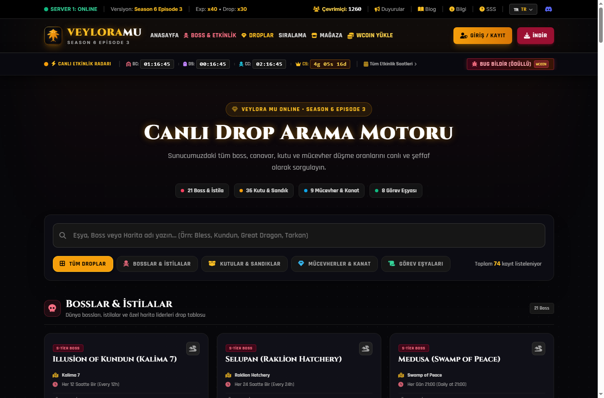
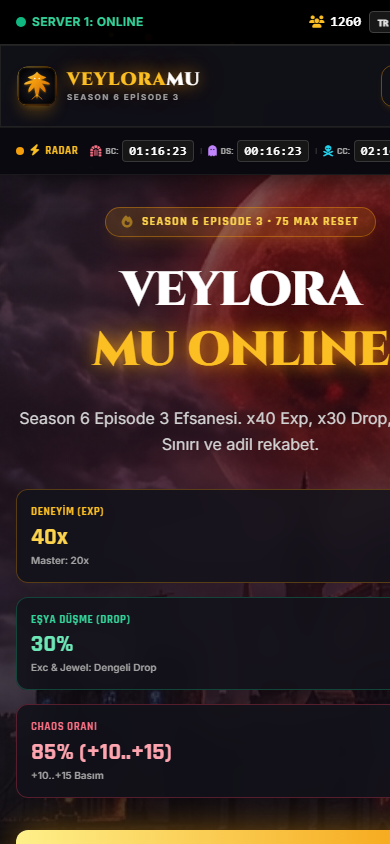

# ⚔️ Next-Gen MU Online Web Panel & CMS (Season 1 to Season 20+)

<div align="center">


<br/>

**A premium, high-performance, mobile-responsive MU Online Web Panel and Content Management System built for modern servers.**  
*Includes a turnkey installation and server integration service for any MU Online server files.*

[🌐 Live Demo (Canlı Demo)](https://veyloramu.com) • [📧 Purchase / Contact (İletişim)](#-commercial-inquiries--contact-ileti%C5%9Fim) • [🇹🇷 Türkçe Açıklama](#-t%C3%BCrk%C3%A7e-tan%C4%B1t%C4%B1m--detaylar)

<br/>

[](https://veyloramu.com)

</div>

---

## 📌 Language Navigation
- [🇬🇧 English Documentation](#-english-overview)
- [🇹🇷 Türkçe Tanıtım & Detaylar](#-t%C3%BCrk%C3%A7e-tan%C4%B1t%C4%B1m--detaylar)

---

## 🇬🇧 English Overview

### 💎 What is this?
This is a **commercial-grade, full-featured MU Online Web Engine & CMS** engineered with modern web standards (PHP 8.2+ PDO, Tailwind CSS, Vanilla JS, and asynchronous REST APIs). It replaces outdated 2000s-era MU panels with an ultra-fast, mobile-first, and SEO-optimized digital portal.

> **Note:** This repository is a product showcase and architectural overview. The core backend source code is closed-source. Full licenses, turnkey deployment, and customization are provided upon purchase.

---

### 🚀 Key Features

| Category | Highlights & Capabilities |
| :--- | :--- |
| **🎨 Modern UI/UX** | Dark fantasy theme built on **Tailwind CSS 3.4**, micro-interactions, responsive mobile drawer menu, zero-dependency lightweight frontend. |
| **🌐 Dynamic Multi-Lingual SEO** | Full 4-language support (**English, Turkish, Spanish, Portuguese**) with automatic localized URL routing (`/news/slug`, `/blog/slug`), dynamic hreflangs, Google JSON-LD schema, and automated sitemap generator. |
| **🗡️ Real-Time Drops & Spot Engine** | Searchable monster drop directory, coordinates, item category filters, drop probability percentages, and boss spawn timetables. |
| **🏆 Competitive Ranking Leagues** | Reset, Master Reset, Level, Guild, and PvP Killer leaderboards with automated weekly reward leagues and reset cap adaptations. |
| **🛍️ Integrated Web Shop & Cash Shop** | Multi-currency (WCoins, CashPoints, Goblin Points, Zen), automated in-game delivery, stock controls, and VIP tier integrations. |
| **🛡️ Enterprise Security** | 100% Prepared PDO statements (SQL Injection immune), strict XSS filtering, rate-limiting, CSRF tokens, and configurable password hashing (MD5, SHA256, BCrypt, Argon2/PBKDF2). |

---

### 🕹️ Supported Server Files & Compatibility

Our universal PDO database abstraction layer allows seamless connectivity to any MU Online emulator or database engine:

| Server Emulator | Database | Supported Seasons | Key Integration Features |
| :--- | :--- | :--- | :--- |
| **OpenMU** | PostgreSQL | Season 6 Ep 3, Season 9+ | Direct DB & REST API bridge, instant Cash Shop delivery, live server status |
| **MuEmu / X-Team** | Microsoft SQL Server | Season 4, Season 6, Season 8 | WCoin / Goblin Points sync, VIP system, Master Reset, character armory |
| **Louis Emulator** | Microsoft SQL Server | Season 4, Season 6, Season 8, S12 | Custom drop list integration, off-leveling stats, custom jewel logs |
| **IGCN** | Microsoft SQL Server | Season 9 through Season 20+ | Modern packet & DB structures, Pentagram & Socket visualizer |
| **DarksTeam / Old School** | MSSQL / MySQL | 97d, 99b, Season 1 - Season 3 | Classic reset engines, simple stat recalculations, retro theme compatibility |

---

### 🛠️ Turnkey Setup & Customization Service (*Anahtar Teslim Kurulum*)

When you purchase the panel, **you do not need to deal with complicated installation manuals or SQL queries**. We handle everything for you:

1. **VPS / VDS Deployment:** Full installation on Linux (Ubuntu/Debian/AlmaLinux) or Windows Server (Nginx, Apache, or Docker).
2. **Database Mapping:** Customized PDO queries mapped precisely to your emulator's database structure and custom item tables.
3. **Custom Branding:** Integration of your server logo, domain, custom color schemes, social media links, and download mirrors.
4. **Automated Cron Jobs:** Setup of automated ranking resets, weekly rewards, database backups, and drop table synchronizations.
5. **Discord Webhook Alerts:** Real-time discord notifications for new registrations, boss kills, and market transactions.
6. **Launch Support:** Direct priority support before and during your server opening day.

---

### 📸 Showcase Gallery

<div align="center">

#### 🗡️ Searchable Monster Drop & Spot Engine
[](https://veyloramu.com/drops.php)

#### 🏆 Player & Guild Ranking Hall of Fame
[](https://veyloramu.com/rankings.php)

#### 📰 Dynamic Multi-Lingual SEO Blog & Announcements
[](https://veyloramu.com/news.php)

#### 📱 100% Mobile Responsive Drawer & Navigation


</div>

---

<br/>

## 🇹🇷 Türkçe Tanıtım & Detaylar

### 💎 Bu Proje Nedir?
Bu proje; eski, hantal ve güvenlik açıklarıyla dolu 2000'li yıllardan kalma klasik MU web panellerini tarihe gömen; **PHP 8.2+ PDO, Tailwind CSS, çok dilli dinamik SEO altyapısı ve modern asenkron API mimarisiyle** sıfırdan geliştirilmiş **ticari MU Online Web Paneli & CMS sistemidir.**

> **Önemli Not:** Bu repository tanıtım ve vitrin amaçlıdır. Çekirdek kaynak kodları kapalı kaynaklı (closed-source) satılmaktadır. Satın alım durumunda tüm files kurulumu ve entegrasyonu tarafımızca anahtar teslim sağlanmaktadır.

---

### 🚀 Öne Çıkan Özellikler

* **Mobil Uyumlu & Ultra Hızlı Arayüz:** TailwindCSS tabanlı karanlık RPG teması, mobil cihazlarda akıcı kayar çekmece menü, harici ağır kütüphaneler barındırmayan hafif mimari.
* **4 Dilli Dinamik SEO & Blog Sistemi:** Türkçe, İngilizce, İspanyolca ve Portekizce dillerinde otomatik slug/URL yönlendirmesi (`/news/slug`, `/blog/slug`), hreflang etiketleri, Google Schema (JSON-LD) ve otomatik dinamik Sitemap.
* **Canlı Monster Drop & Spot Kılavuzu:** Oyuncuların harita, canavar, item ve boss bazlı anlık arama yapabildiği oran ve koordinat gösterimli düşen eşya veritabanı.
* **Haftalık / Aylık Sıralama Yarışları:** Seviye, Reset, Grand Reset, Guild ve PvP skorlarına göre geri sayımlı lig ödül sistemi.
* **Entegre Web Market / Cash Shop:** WCoin, CashPoints, Goblin Points ve Zen desteği; oyundan çıkış yapmayı gerektirmeyen anında envanter/kasa teslimatı.
* **Yüksek Güvenlik Standartları:** %100 Prepared PDO sorguları (SQL Injection imkansız), XSS koruması, Rate-Limiting (Brute-force kalkanı) ve modern şifreleme algoritmaları (MD5, SHA256, BCrypt, PBKDF2).

---

### 🛠️ Anahtar Teslim Kurulum & Entegrasyon Hizmeti

Panelimizi satın aldığınızda teknik detaylarla, SQL tablolarıyla veya sunucu ayarlarıyla **asla uğraşmazsınız**. 

1. **Sunucuya Kurulum:** VDS/VPS sunucunuza (Linux, Windows Server, Nginx, Apache veya Docker) kurulumu biz yapıyoruz.
2. **Files Entegrasyonu:** Kullandığınız MU filesına (OpenMU, Louis, MuEmu, IGCN vb.) özel veritabanı eşleştirmelerini ve özel item/drop tablolarını eksiksiz bağlıyoruz.
3. **Özel Tasarım Uyarlaması:** Sunucunuzun logosu, renk tonları, indirme linkleri ve sosyal medya butonları yerleştirilir.
4. **Otomasyon & Cronjob:** Otomatik lig ödülleri, sitemap yenileme ve veritabanı optimize cronjob'ları ayarlanır.
5. **Discord Bildirim Botu:** Kayıtlar, market alışverişleri ve sunucu duyuruları için Discord webhook entegrasyonu sağlanır.
6. **Açılış Desteği:** Sunucunuzun açılış gününde teknik ekibimiz hazır bekler.

---

## 📬 Commercial Inquiries & Contact (İletişim)

Paneli satın almak, demo detaylarını görüşmek veya sunucunuza özel teklif almak için bize e-posta yoluyla ulaşabilirsiniz:

- 📧 **Official Email:** [hellonullen@gmail.com](mailto:hellonullen@gmail.com)
- 🌐 **Live Server Demo:** [https://veyloramu.com](https://veyloramu.com)
- 💬 **Discord / Telegram:** *Yakında eklenecektir (talep üzerine e-posta ile iletilir)*

---

## 📄 License & Intellectual Property

```
Copyright (c) 2026 Veylora / Apex MU Web Solutions. All Rights Reserved.
This project is proprietary commercial software. Unauthorized copying, 
decompilation, distribution, or resale is strictly prohibited.
```
